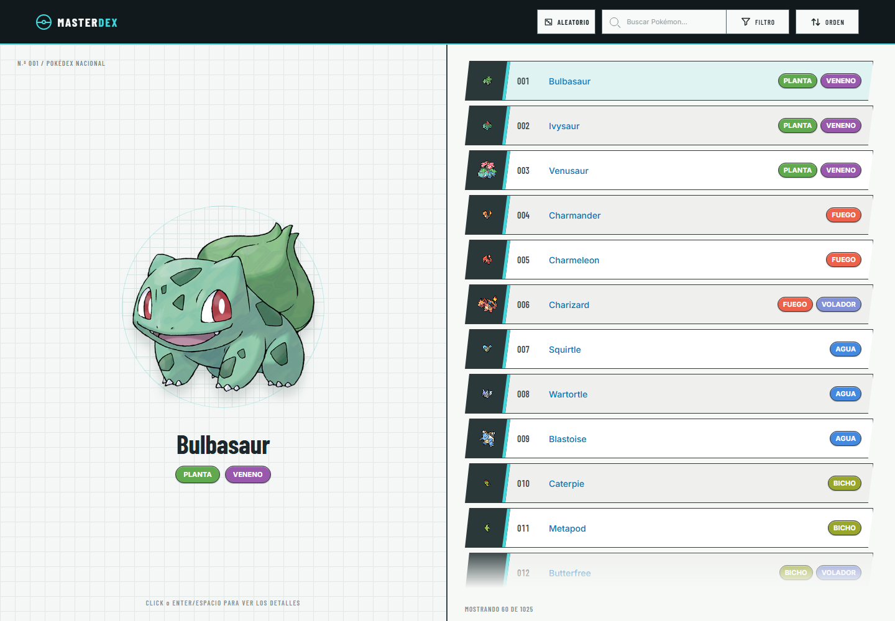
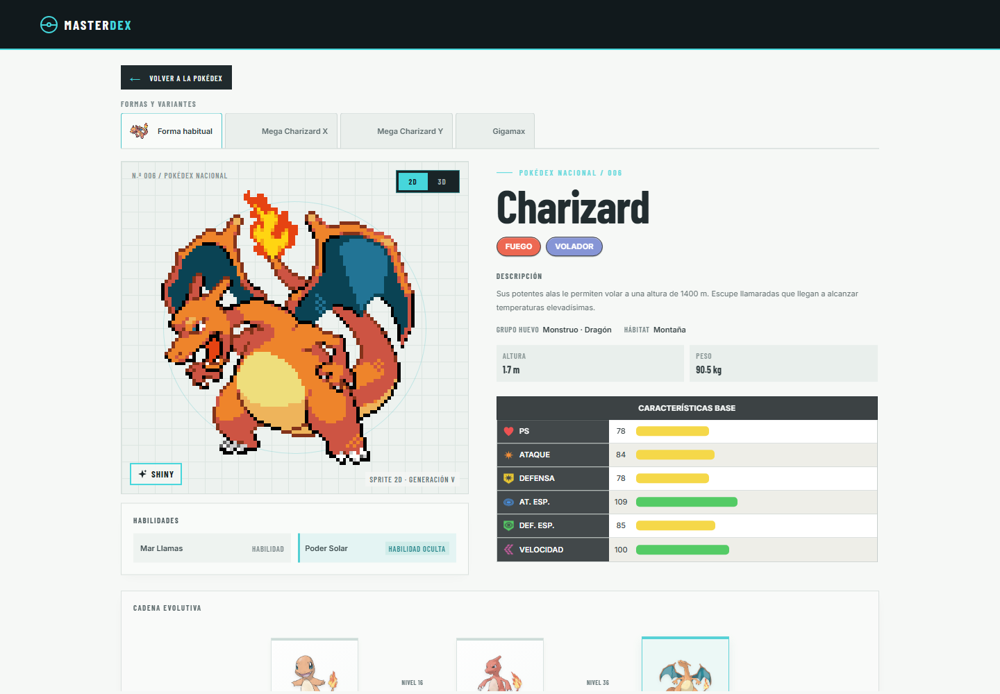
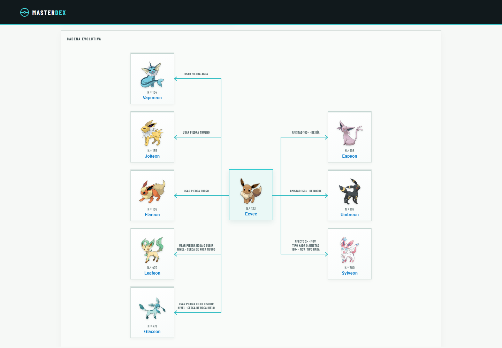
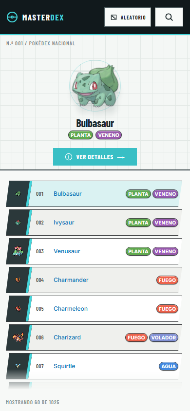

# 

**Tu próxima aventura por la Pokédex comienza aquí.**

¿Y si abrir la Pokédex fuera el comienzo de una aventura y no solo una búsqueda? MasterDex te invita a recorrer las **1.025 especies** de la Pokédex Nacional, reencontrarte con tus favoritos y descubrir Pokémon que quizá todavía no conocías. No es solo un catálogo: es un lugar para saltar de una ilustración a una ficha, de una ficha a una evolución y de ahí a tu próximo favorito. Una experiencia en español, creada por fans y diseñada para disfrutar cada descubrimiento.

**[Explorar MasterDex](https://masterdex-pk.vercel.app/)**

## Una Pokédex para perderse y encontrar algo nuevo

Busca por nombre o número, filtra por región y tipo y ordena el catálogo a tu manera. ¿No sabes a quién buscar? Pulsa **ALEATORIO** y deja que la Pokédex elija tu próximo descubrimiento. Cada Pokémon puede abrir la puerta a otro: sus formas, sus evoluciones, sus movimientos y las conexiones que los hacen únicos.

En ordenadores, puedes recorrer la lista con el ratón o el teclado y ver una ilustración en la previsualización. En dispositivos táctiles, el primer toque muestra el Pokémon; puedes observarlo y luego abrir su ficha con otro toque o con **VER DETALLES**. Así, explorar el catálogo también se siente como hojear una Pokédex.

## Una ficha que invita a conocer cada detalle

Cada ficha reúne datos para mirar al Pokémon desde distintos ángulos: su descripción, tipos, habilidades, altura, peso, hábitat y características base. Las pestañas de formas y variantes permiten descubrir sus diferentes apariencias, mientras que los modos visuales **2D** y **3D** y la opción **Shiny** te dejan elegir cómo quieres verlo cuando esos recursos están disponibles.

Las habilidades también tienen algo que contar: selecciónalas para leer su descripción. El contenido en español se muestra primero; si solo hay una descripción en inglés, puedes solicitar una traducción y volver al texto original cuando quieras.

## Evoluciones conectadas, historias por descubrir

Las cadenas evolutivas muestran cómo se relacionan los Pokémon, incluidas las líneas con varias ramificaciones y sus requisitos. Las conexiones guían la mirada entre cada etapa y cada alternativa, para que sea fácil seguir el recorrido y comparar sus caminos. Además, puedes abrir la ficha de cualquiera de sus integrantes directamente desde el diagrama.

## Mira más allá de la apariencia

Consulta los movimientos que cada Pokémon aprende por nivel, junto con su tipo y categoría. También puedes revisar cómo responde cada combinación de tipos ante los ataques: descubre fortalezas, resistencias e inmunidades de un vistazo.

Las estadísticas base completan el retrato de cada especie. Sus valores e iconos hacen más fácil comparar sus características de un vistazo y apreciar que cada Pokémon destaca a su manera.

## Hecha para acompañarte

La Pokédex se adapta a ordenadores, tabletas y teléfonos móviles para que puedas explorar estés donde estés. La navegación y las fichas se reorganizan para cada pantalla, y los controles táctiles facilitan consultar el catálogo y descubrir más información.

## Un mundo visual propio

MasterDex combina cuadrículas técnicas, acentos cian, animaciones sutiles y una Poké Ball que acompaña la carga de las ilustraciones. La estética evoca las Pokédex de los videojuegos y, especialmente, la tecnología de la quinta generación. Cada detalle busca que explorar los datos se sienta tan especial como encontrar un Pokémon nuevo.

Los datos de la Pokédex se apoyan en [PokéAPI](https://pokeapi.co/), mientras que la experiencia visual y la forma de recorrer la información tienen una identidad propia, creada con cariño por fans de Pokémon.

## ¿Quieres conocer el proyecto por dentro?

Si quieres instalar MasterDex, explorar el código, ejecutar las pruebas o publicar tu propia instancia, consulta la [guía del proyecto](GUIDE.md).

## Créditos

Los datos y recursos gráficos de Pokémon se obtienen de servicios públicos de la comunidad, entre ellos PokéAPI y su repositorio de sprites. La disponibilidad de imágenes puede variar según el Pokémon, la forma o el modo visual.

MasterDex es un proyecto creado por fans y no está afiliado, respaldado ni aprobado por Nintendo, Game Freak o The Pokémon Company. Pokémon y los nombres relacionados son marcas de sus respectivos propietarios.
